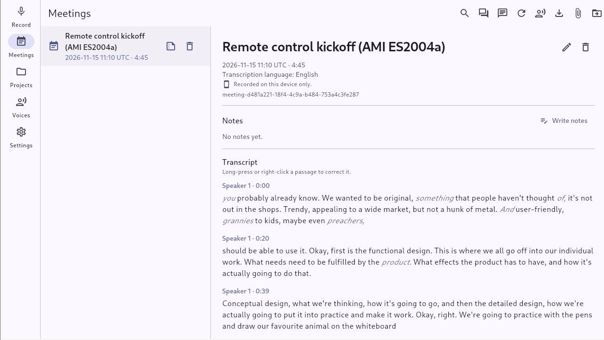
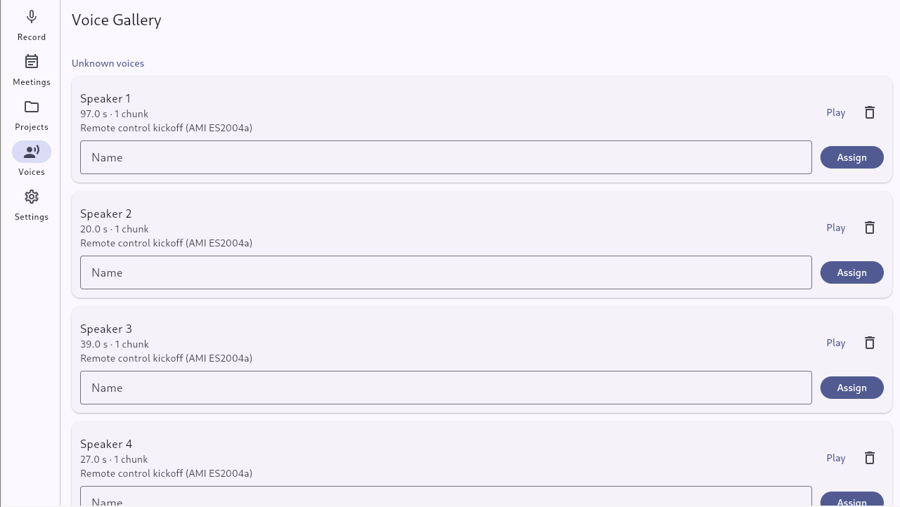
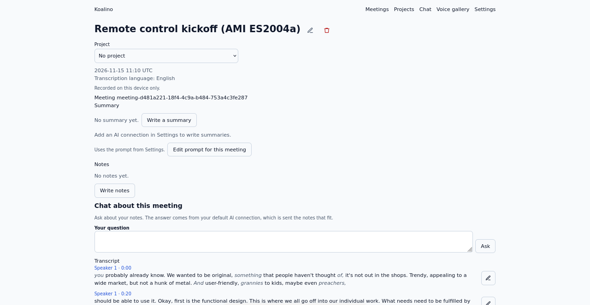
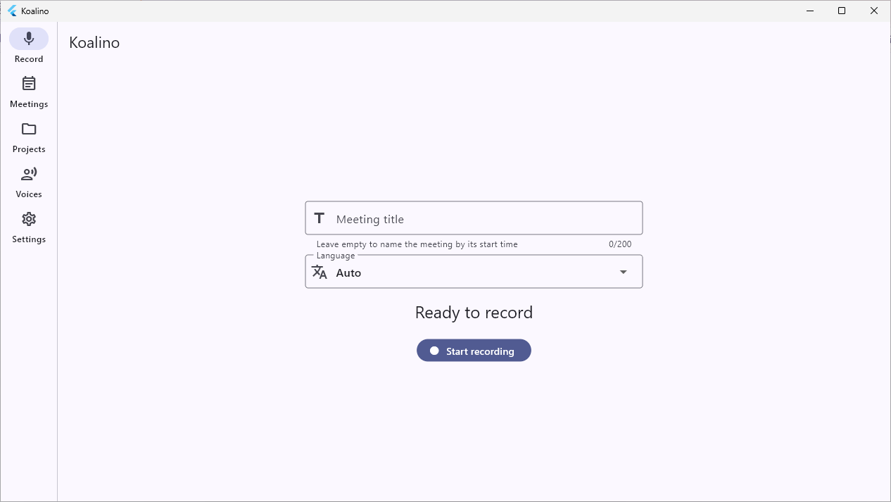
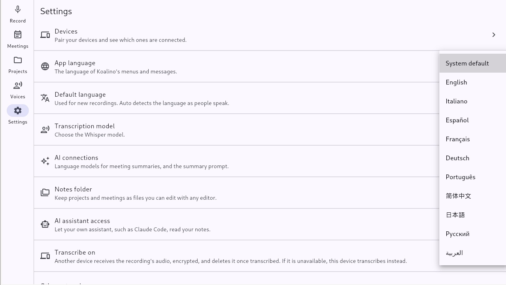
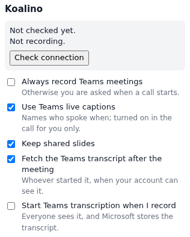

<!-- Provides the project entry point: what Koalino is, how to build and run it, and how to configure it. -->

<p align="center">
  
</p>

# Koalino

Koalino is a decentralized, offline-first meeting-notes application. It records meetings,
transcribes them on the device with Whisper (whisper.cpp),
groups transcript segments into known and unknown voices, and keeps notes in a CRDT-backed SQLite
store. Voice embeddings, transcripts and meeting documents are encrypted at rest. The Rust core uses hexagonal architecture
(ports and adapters), so you can swap the AI, network, storage, and export implementations
without touching domain logic.

**Free, and always will be:** free as in freedom, because Koalino is free software under the GPL
(`GPL-3.0-or-later`), and free as in no payments: no price, subscription or premium tier. It runs
on your own devices, so there is no service to pay for. (Optional AI summaries can use a service
you connect yourself, which may charge you directly.)

> **Status: preview (0.2.0).** Everything below works today on Linux, Windows and Android, and
> the packages are preview builds. Since 0.2.0 the application ID and the Android signing key are
> the permanent ones. See [AUDIT_V1.md](AUDIT_V1.md) for the compliance matrix and readiness assessment.

## Features

**Recording and transcription, on your devices**
- Transcribes with Whisper ([whisper.cpp](https://github.com/ggml-org/whisper.cpp)) on the device,
  offline: on the desktop GPU (Vulkan), and on a phone's CPU, GPU or NPU. Whisper `base` ships
  with the app; *Automatic* chooses the model this device keeps up with.
- Detects the language as people speak, or uses the one you choose; a glossary teaches it names
  and project terms.
- After the meeting, a second pass re-transcribes it in longer windows for a cleaner text.
- On a computer, records the call's sound as a second track beside the microphone, and offers to
  record when a call starts.
- Marks words it is unsure of and passages where people spoke over each other.

**Who said what**
- On-device speaker diarization: voices are told apart as "Speaker 1", "Speaker 2"…
- Name a voice once in the voice gallery, and Koalino recognises it in later meetings.
- Takes speaker names from the call window or the Teams captions when it can.

**Notes**
- Meetings, notes and summaries, which you can edit, including the transcript.
- Every meeting in one place, on all your devices: transcripts, notes, photos and files together.
- Projects that gather meetings, notes, files and e-mails; search across everything.
- Export to Markdown, PDF and JSON; an optional notes folder mirrors everything as plain files you
  can edit with any editor.

**AI, only if you want it**
- Meeting summaries and chat with your notes, with answers that link to the moment they cite,
  through a language model you choose: a local server (Ollama, llama.cpp, LM Studio…) or, on a
  computer, your own Claude Code or Codex sign-in. A phone can ask a paired computer to do it.
- A read-only MCP server lets your own AI assistant read your notes.

**Your devices, no cloud**
- Peer-to-peer sync between your devices (libp2p, end-to-end encrypted), paired with a QR code;
  everything works offline and syncs later.
- One meeting recorded on several devices is combined into one.
- Notes, transcripts, voice signatures and files are encrypted at rest (AES-256-GCM, key in the
  system keychain). Recorded speech is deleted once it is no longer needed.
- On Android, back up everything into one passphrase-encrypted file, by hand or automatically
  every day into a folder you choose, local or in your own cloud (Google Drive, Nextcloud,
  OneDrive…). The file is encrypted before it leaves the phone.

**In the room or online**
- In person: put a phone or a laptop on the table; its microphone records the room.
- Calls in any app on a computer (Zoom, Teams, Google Meet, Webex, Slack, Discord, Jitsi…):
  Koalino records your microphone and the call's sound, and offers to record when a call starts.
- For Teams in the browser, an extension for Firefox, Chrome and Edge adds live captions, shared
  slides and, after the meeting, the Teams transcript. A Teams bot does the same for meetings it
  is invited to.

**In ten languages**: English, Italian, Spanish, French, German, Portuguese, Chinese (Simplified),
Japanese, Russian and Arabic, following the system language.

## Screenshots

| | |
| --- | --- |
|  |  |
| *A meeting in the Linux app: speakers, times, and uncertain words in grey.* | *The voice gallery: name a voice once.* |
|  |  |
| *The web dashboard of the server package.* | *The Windows app.* |
|  |  |
| *The app in ten languages.* | *The browser extension.* |

The meeting shown is an excerpt of meeting ES2004a from the
[AMI Meeting Corpus](https://groups.inf.ed.ac.uk/ami/corpus/) (CC BY 4.0), transcribed by Koalino.

## Download

Preview packages for 0.2.0 are on the
[v0.2.0-preview.2 release page](https://github.com/capannone-dev/koalino/releases/tag/v0.2.0-preview.2),
with their SHA-256 sums in `SHA256SUMS.txt`.

| Platform | Package | Contents |
| --- | --- | --- |
|   Linux desktop (x86_64): Debian 13+, Ubuntu 24.04+ | [`koalino_0.2.0.preview.2_amd64.deb`](https://github.com/capannone-dev/koalino/releases/download/v0.2.0-preview.2/koalino_0.2.0.preview.2_amd64.deb) | The app, Whisper `base`, the diarization models, the MCP server and the browser extension's host, with a menu entry |
|   Linux desktop (x86_64): Fedora, openSUSE | [`koalino-0.2.0.preview.2-1.x86_64.rpm`](https://github.com/capannone-dev/koalino/releases/download/v0.2.0-preview.2/koalino-0.2.0.preview.2-1.x86_64.rpm) | The same, as an RPM |
|   Linux desktop (x86_64): any distribution | [`koalino-x86_64-0.2.0.flatpak`](https://github.com/capannone-dev/koalino/releases/download/v0.2.0-preview.2/koalino-x86_64-0.2.0.flatpak) or [`koalino-linux-x86_64-0.2.0.tar.gz`](https://github.com/capannone-dev/koalino/releases/download/v0.2.0-preview.2/koalino-linux-x86_64-0.2.0.tar.gz) | The same, as a Flatpak bundle or a tarball (Debian 13-era libraries or newer) |
|  Windows desktop (x86_64, Windows 10 or 11) | [`koalino-windows-x86_64-0.2.0-setup.exe`](https://github.com/capannone-dev/koalino/releases/download/v0.2.0-preview.2/koalino-windows-x86_64-0.2.0-setup.exe) (installer) or [`koalino-windows-x86_64-0.2.0.zip`](https://github.com/capannone-dev/koalino/releases/download/v0.2.0-preview.2/koalino-windows-x86_64-0.2.0.zip) (portable) | The same, for Windows |
|  macOS desktop (Intel and Apple silicon, macOS 12 or newer) | [`koalino-macos-universal-0.2.0.zip`](https://github.com/capannone-dev/koalino/releases/download/v0.2.0-preview.2/koalino-macos-universal-0.2.0.zip) | The same, for Mac, built on GitHub Actions; untested on real Macs and paused ([help wanted](#apple-devices-help-wanted)); on Intel Macs without speaker diarization |
|  Android (64-bit ARM) | [`koalino-android-arm64-0.2.0.apk`](https://github.com/capannone-dev/koalino/releases/download/v0.2.0-preview.2/koalino-android-arm64-0.2.0.apk) | The app with Whisper `base` and the diarization models |
|  Linux server (x86_64, Debian 13 or newer) | [`koalino-server-linux-x86_64-0.2.0.tar.gz`](https://github.com/capannone-dev/koalino/releases/download/v0.2.0-preview.2/koalino-server-linux-x86_64-0.2.0.tar.gz) | `daemon` (HTTP API and sync), `cli`, `dashboard` (web UI), the browser extension's host, and the models |
|  Chrome, Edge, Chromium | [`koalino-browser-extension-chromium-0.2.0.zip`](https://github.com/capannone-dev/koalino/releases/download/v0.2.0-preview.2/koalino-browser-extension-chromium-0.2.0.zip) | The browser extension, to load unpacked |
|  Firefox (140 or newer) | [Koalino on Firefox Add-ons](https://addons.mozilla.org/addon/66e641dc7c544efb8b82/) | The browser extension, from Mozilla's add-ons site; Firefox keeps it up to date. The signed [`.xpi`](https://github.com/capannone-dev/koalino/releases/download/v0.2.0-preview.2/koalino-browser-extension-firefox-0.2.0.xpi) installs the same by hand |

## Install

### Linux desktop

The `.deb` and `.rpm` put Koalino in the applications menu and `koalino` on the path:

```sh
sudo apt install ./koalino_0.2.0.preview.2_amd64.deb      # Debian, Ubuntu
sudo dnf install ./koalino-0.2.0.preview.2-1.x86_64.rpm   # Fedora (openSUSE: sudo zypper install)
flatpak install --user koalino-x86_64-0.2.0.flatpak       # any distribution with Flatpak
```

Or unpack the tarball anywhere:

```sh
sudo apt install libgtk-3-0t64 libasound2t64 libstdc++6   # usually present on a desktop
tar -xzf koalino-linux-x86_64-0.2.0.tar.gz
koalino-linux-x86_64-0.2.0/note_taker_ui
```

Koalino keeps its encryption key in the desktop keychain (GNOME Keyring, KWallet). Without one,
start it with `NOTE_TAKER_ENCRYPTION_PASSPHRASE` set. Data lives in
`~/.local/share/io.github.capannone_dev.koalino/`.

### Windows

Run `koalino-windows-x86_64-0.2.0-setup.exe`. It installs Koalino for your user only, with no
administrator rights, into `%LOCALAPPDATA%\Programs\Koalino`, with Start menu and desktop shortcuts;
uninstall it from **Settings → Apps** (your meetings are kept). The preview is not code signed, so
SmartScreen may warn: choose **More info → Run anyway**. To run Koalino without installing it,
unzip `koalino-windows-x86_64-0.2.0.zip` and run `note_taker_ui.exe`. The key is kept in Windows
Credential Manager, and data lives in `%APPDATA%\capannone-dev\Koalino\`.

### macOS

Unzip `koalino-macos-universal-0.2.0.zip` and drag **Koalino** into Applications. The preview is
not notarized by Apple, so the first start is blocked: open it once, then go to **System Settings →
Privacy & Security** and choose **Open Anyway**. Koalino asks for the microphone the first time it
records, and keeps its key in the login Keychain. Data lives in
`~/Library/Application Support/io.github.capannone-dev.koalino/`. For the browser extension, run
`/Applications/Koalino.app/Contents/MacOS/browser-host install` in Terminal.

Limits of this preview: on Intel Macs recordings are transcribed but not split by speaker, because
ONNX Runtime, which diarization uses, no longer ships for Intel Macs. Capturing the computer's own
sound is not available on macOS yet. The core (transcription, Keychain, database) was tested on an
Intel Mac; the window itself and the Apple silicon build have not been tried on real hardware yet.

#### Apple devices: help wanted

Work on macOS and iOS is **paused**. The maintainer has no Apple hardware (Mac, iPhone or iPad)
and no Apple Developer Program membership. So the macOS package above stays an untested, unsigned
preview, and there is no iPhone or iPad app. Without the membership Apple allows no notarized Mac
download and no App Store release; without a Mac nothing can be tried on real hardware.

If you develop for Apple platforms and would like to bring Koalino to Mac, iPhone or iPad,
you are very welcome. Open an issue or comment on
[#151](https://github.com/capannone-dev/koalino/issues/151). Useful help, from smallest to
largest:

- try the macOS preview on a real Mac (especially Apple silicon) and report what works;
- fix the macOS build where it fails: [`tools/macos/README.md`](tools/macos/README.md) explains
  how it is built;
- port the app to iOS and iPadOS. The interface is Flutter and the core is Rust, so the work is
  mostly the iOS runner, microphone and background recording, the Keychain, and building the core
  for iOS.

### Android

Copy the APK to a 64-bit phone and open it, allowing installs from that app when Android asks.
Koalino asks for the microphone, and for notifications so it can keep recording with the screen
off. From 0.2 the APK is signed with Koalino's release key, so later releases update it in place.

From version 0.2, Koalino's ID is `io.github.capannone_dev.koalino`, so it installs as a new app
beside the 0.1 preview (`com.example.note_taker_ui`). To bring your meetings over:

1. Install [`koalino-android-arm64-0.1.0-backup.apk`](https://github.com/capannone-dev/koalino/releases/download/v0.2.0-preview.2/koalino-android-arm64-0.1.0-backup.apk)
   over the preview. It is the 0.1 preview plus backups, and keeps its data.
2. In it, open **Settings → Back up all data** and choose a passphrase.
3. Install the 0.2 APK, open **Settings → Restore from backup** and pick the file.
4. Uninstall the preview. Desktop apps move their data to the new folder by themselves on
first start and leave a `MOVED-TO-KOALINO.txt` note in the old one.

### Linux server

```sh
sudo apt install libstdc++6 nodejs        # Node.js 20 or newer, for the dashboard only
tar -xzf koalino-server-linux-x86_64-0.2.0.tar.gz && cd koalino-server-linux-x86_64-0.2.0
export NOTE_TAKER_ENCRYPTION_PASSPHRASE='…'   # or rely on the system keychain
./daemon &                                # API on 127.0.0.1:8080
./dashboard &                             # web UI: open http://localhost:3000
./cli meetings list
./cli record start --title "Weekly sync" --input meeting.wav
```

The dashboard talks to the daemon from your browser, so open it on the server itself or through
an SSH tunnel (`ssh -L 3000:127.0.0.1:3000 -L 8080:127.0.0.1:8080 server`). For a systemd
service and the other settings, see [`server/README.md`](server/README.md) and
[Configuration](#configuration).

### Browser extension (Teams in the browser)

1. Register the extension's helper once, from the desktop app's folder or the server package:
   `browser-host install` (`browser-host.exe install` on Windows; the server package has it in
   `bin/`).
2. Keep the Koalino app open, or on a server run the daemon with
   `NOTE_TAKER_TEAMS_BRIDGE_ENABLED=true`.
3. Firefox: open [Koalino on Firefox Add-ons](https://addons.mozilla.org/addon/66e641dc7c544efb8b82/) and press **Add to Firefox**.
   Chrome, Edge or Chromium: unzip the extension, open `chrome://extensions` (`edge://extensions`),
   turn on **Developer mode**, choose **Load unpacked** and pick the unzipped folder.
4. Open the extension's popup: it says whether Koalino is reachable, and asks for access to Teams
   if the browser has not granted it.

When a Teams call starts, Koalino asks whether to record it. Tell the other participants; a
notice to paste in the meeting chat is in [`docs/meeting-consent-notice.md`](docs/meeting-consent-notice.md).
More in [`browser-extension/README.md`](browser-extension/README.md).

## Components

| Directory | What it is | Stack |
| --- | --- | --- |
| [`core/`](core/README.md) | Domain, application services, ports and adapters, plus the `cli`, `daemon`, and FFI (`libnote_taker_core`) entry points | Rust |
| [`ui/`](ui/README.md) | Desktop (Linux/Windows) and Android app, which calls the core through its C ABI | Flutter |
| [`web/`](web/README.md) | Dashboard for the headless daemon (meetings, voice gallery, telemetry) | Next.js |
| [`teams-bot/`](teams-bot/README.md) | Microsoft Teams media bot that streams meeting audio and slides to the daemon | C# / .NET |
| [`browser-extension/`](browser-extension/README.md) | Firefox/Chrome/Edge extension that records Teams meetings joined in the browser (audio, captions, slides, the Teams transcript) and sends them to the daemon through the `browser-host` native messaging host | TypeScript |
| [`server/`](server/README.md) | Headless Linux deployment notes (systemd, background recording) | — |

## Building from source

Prerequisites: a stable Rust toolchain. Add the Flutter SDK for `ui/`, Node.js for `web/`, and
the .NET SDK for `teams-bot/`.

```sh
make rust-lint        # cargo fmt --check + cargo clippy -D warnings
make rust-test        # unit tests (AI models are mocked)
make build-server     # target/debug/daemon
cargo build --bin cli # target/debug/cli
cargo build --lib     # target/debug/libnote_taker_core.so, loaded by the Flutter app
make flutter-lint && make flutter-test
make build-desktop    # Flutter Linux desktop bundle
```

The default build has no native model dependencies. Opt into on-device inference with Cargo
features:

```sh
cargo build --features local-ai,vad   # whisper.cpp (needs cmake and a C++ toolchain) + WebRTC VAD
cargo build --features diarization    # speaker diarization; downloads ONNX Runtime at build time
```

Run with `NOTE_TAKER_WHISPER_MODEL` set to a GGML model, such as whisper.cpp's multilingual
`ggml-base.bin`. To build the daemon and CLI for Windows and Android from Linux, with whisper.cpp,
see [`tools/cross/README.md`](tools/cross/README.md).
To build and package the macOS app on a Mac with Xcode, see
[`tools/macos/README.md`](tools/macos/README.md).

For the web dashboard: `cd web && npm install && npm run dev`. For the Teams bot, see
[`teams-bot/README.md`](teams-bot/README.md). For the browser extension and its native host
(`cargo build --bin browser-host`), see [`browser-extension/README.md`](browser-extension/README.md).

## Running

```sh
export NOTE_TAKER_ENCRYPTION_PASSPHRASE='…'   # or rely on the platform keychain
target/debug/daemon                           # HTTP/WebSocket API on 127.0.0.1:8080
target/debug/cli meetings list
target/debug/cli record start --title "Weekly sync" --input meeting.wav
target/debug/cli record start --title "Standup"   # the microphone (--features microphone)
target/debug/cli record start --language it --input riunione.wav   # this meeting in Italian
target/debug/cli log-level debug              # a running daemon applies it within 2 s
target/debug/cli devices list                 # devices this database syncs with
target/debug/cli devices revoke "My phone"    # a running daemon stops syncing with it within 1 s
```

The full CLI, HTTP, WebSocket, and C ABI contracts are in [API_SPECS.md](API_SPECS.md).

## Configuration

Everything is configured through environment variables. Secrets never live in files in the
repository.

| Variable | Default | Purpose |
| --- | --- | --- |
| `NOTE_TAKER_DATABASE_PATH` | `note_taker.sqlite3` | SQLite database. The control files `<db>.device-id`, `<db>.log-level`, and `<db>.recording-stop` sit beside it |
| `NOTE_TAKER_DEVICE_ID` | generated once, stored in `<db>.device-id` | Acquisition device ID stamped on notes and logs |
| `NOTE_TAKER_ENCRYPTION_PASSPHRASE` | unset | Derives the AES-256-GCM key with Argon2id. If unset, a random key is kept in the platform keychain or a key file |
| `NOTE_TAKER_KEYCHAIN_ENABLED` | `true` | `false`/`0`/`no`/`off` skips the keychain and uses the key file |
| `NOTE_TAKER_ENCRYPTION_KEY_DIR` | `~/.note_taker` | Directory of the fallback `encryption.key` |
| `NOTE_TAKER_LOG_DIR` | `logs` | Daily rolling JSON log files (`app_log.YYYY-MM-DD`) |
| `RUST_LOG` | `info` (daemon) | Initial daemon log filter. CLI: `--log-level` |
| `NOTE_TAKER_BIND_ADDRESS` | `127.0.0.1:8080` | Daemon HTTP/WebSocket address |
| `NOTE_TAKER_P2P_ENABLED` | `true` | Daemon pairing and sync with your other devices. `false` turns it off |
| `NOTE_TAKER_P2P_LISTEN` | `/ip4/0.0.0.0/tcp/0` | libp2p listen multiaddress (port 0 picks a free port). Only paired devices can connect, except during pairing |
| `NOTE_TAKER_DEVICE_NAME` | the host name | Name shown to your other devices during pairing |
| `NOTE_TAKER_P2P_PEERS` | unset | Comma-separated `…/p2p/<peer-id>` addresses of your devices that mDNS cannot find (another subnet, NAT, VPN). They appear as nearby for pairing. Paired devices, configured or found by mDNS, are redialed every 10 s while disconnected |
| `NOTE_TAKER_WHISPER_MODEL` | unset | Path to the local GGML model (`local-ai` builds) |
| `NOTE_TAKER_WHISPER_GPU` | on | `off` keeps local transcription on the CPU in GPU builds |
| `NOTE_TAKER_WHISPER_LANGUAGE` | `auto` | Language detection, or a code such as `it` or `en`, for recordings without `--language`; kept in each meeting's details |
| `NOTE_TAKER_TRANSCRIPT_PASS` | on (a phone runs it while charging) | After Stop, transcribe the meeting again in 30 s windows and replace its text. Speech is kept encrypted until then, and deleted after |
| `NOTE_TAKER_TRANSCRIPT_PASS_MODEL` | the live model | GGML model for that pass, for example a larger one than live transcription uses (`local-ai` builds) |
| `NOTE_TAKER_VAD_ENABLED` | `true` | Voice-activity chunking. `false` cuts near every 15 s |
| `NOTE_TAKER_P2P_RELAY` | unset | `…/p2p/<peer id>` address of your relay, to reach devices across NATs. It must be paired with this device. In the apps, set it in Settings → Other networks instead; a saved value replaces this one |
| `NOTE_TAKER_P2P_RELAY_SERVER_ADDRESS` | unset | On your always-on daemon: its public address (`/ip4/203.0.113.5/tcp/4001`), which turns the relay on. Use a fixed port in `NOTE_TAKER_P2P_LISTEN` |
| `NOTE_TAKER_ENABLE_DIARIZATION` | `false` | Speaker diarization (`diarization` builds, with both models below). Otherwise segments are unattributed |
| `NOTE_TAKER_DIARIZATION_SEGMENTATION_MODEL` | unset | Path to `segmentation.onnx`, from [`tools/diarization`](tools/diarization/README.md) |
| `NOTE_TAKER_DIARIZATION_EMBEDDING_MODEL` | unset | Path to `embedding.onnx`, from the same tool |
| `NOTE_TAKER_REVIEW_CLIP_DIR` | `voice_review_clips` | Temporary clips of unknown voices, kept until resolved |
| `NOTE_TAKER_EXPORT_DIR` | `~/Documents/NoteTaker/exports` | Export destination |
| `NOTE_TAKER_PDF_FONT_DIR` | unset | Extra fallback fonts for PDF export |
| `NOTE_TAKER_TEAMS_BRIDGE_ENABLED` | `false` | Starts the Teams bot bridge in the daemon |
| `NOTE_TAKER_TEAMS_BRIDGE_PORT` | `8765` | Bridge port (always bound to 127.0.0.1) |
| `NOTE_TAKER_TEAMS_BRIDGE_SECRET` | unset | Shared secret the Teams bot authenticates with |
| `NOTE_TAKER_TEAMS_BRIDGE_BUFFER_SECONDS` | `10` | Audio buffered before transcription (1–300) |
| `NOTE_TAKER_TEAMS_BRIDGE_SLIDE_DIR` | `slides` beside the database | Where Teams slide screenshots are stored |
| `NEXT_PUBLIC_API_BASE_URL` | `http://127.0.0.1:8080` | Web dashboard: daemon API |
| `NEXT_PUBLIC_WS_URL` | derived from the API URL | Web dashboard: live-transcript WebSocket |

## License

Koalino is free software, licensed under the GNU General Public License, version 3 or (at your
option) any later version (`GPL-3.0-or-later`); see [LICENSE](LICENSE). The components it builds
on, and their licenses, are listed in [THIRD_PARTY_NOTICES.md](THIRD_PARTY_NOTICES.md), which
`tools/licenses/third_party_notices.py` generates.

The application ID is `io.github.capannone_dev.koalino` (`io.github.capannone-dev.koalino` on
macOS, where IDs cannot contain underscores). Binary and crate names, `NOTE_TAKER_*` variables,
the `note_taker` data subfolder and keychain entries keep their internal names.

## Project documents

- [Architecture](ARCHITECTURE.md)
- [Requirements](REQUIREMENTS.md)
- [API contract](API_SPECS.md)
- [v1.0 audit](AUDIT_V1.md)
- [Engineering context](CONTEXT.md)
- [Task board](TASK_BOARD.md)
- [Decision log](DECISION_LOG.md)
- [Contributing guidelines](CONTRIBUTING.md)
